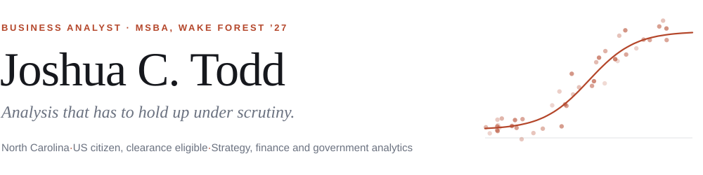
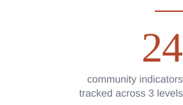

<picture><source media="(prefers-color-scheme: dark)" srcset="assets/dark/header.svg"></picture>

[Portfolio site](https://jcurrietodd.github.io/) &nbsp;·&nbsp; [Résumé](Business_Analytics_Resume_JT.pdf) &nbsp;·&nbsp; [LinkedIn](https://linkedin.com/in/joshuactodd1) &nbsp;·&nbsp; [Email](mailto:toddj26@gmail.com) &nbsp;·&nbsp; [Video introduction ↗](https://www.youtube.com/watch?v=nPPuKVAcSIM)

 

<picture><source media="(prefers-color-scheme: dark)" srcset="assets/dark/label-about.svg"></picture>

I'm a business analytics graduate student at Wake Forest University. Before graduate school I spent two years doing applied analytics for government and community organizations in Spartanburg, SC: mapping food insecurity across census tracts, assessing credit risk for small business loan applicants, and presenting findings to officials whose policy decisions depended on the analysis being right.

In the MSBA I've moved into machine learning, building fraud models where the cut-off has to balance dollars saved against what a review team can actually handle. I'm drawn to work where the analysis has real stakes: defense and government consulting, financial services, and public-sector strategy.

 

<picture><source media="(prefers-color-scheme: dark)" srcset="assets/dark/label-work.svg"></picture>

<a href="https://github.com/jcurrietodd/dfs-fraud-detection"><picture><source media="(prefers-color-scheme: dark)" srcset="assets/dark/metric-dfs.svg"></picture></a>

### 01&nbsp; [Digital Banking Fraud Detection](https://github.com/jcurrietodd/dfs-fraud-detection)
*Wake Forest MSBA Analytics Challenge · 2026*

The lesson I keep coming back to from this one: the best model isn't the one with the highest AUC, it's the one the review team can actually keep up with. A digital bank's $200 sign-up bonus brought a fivefold jump in applications, and fraud came with it. Our four-person team compared five models on 192,142 applications and recommended piloting XGBoost at a 0.07 cut-off, which saves about $242K a month without overflowing the review queue.

PYTHON · XGBOOST · SCIKIT-LEARN · OPTUNA · COST MODELING &nbsp; [Read more →](https://github.com/jcurrietodd/dfs-fraud-detection)

 

<a href="https://github.com/jcurrietodd/government-community-analytics"><picture><source media="(prefers-color-scheme: dark)" srcset="assets/dark/metric-gca.svg"></picture></a>

### 02&nbsp; [Government & Community Analytics](https://github.com/jcurrietodd/government-community-analytics)
*Strategic Spartanburg · Community Data Analyst*

Geospatial dashboards mapping food insecurity and economic mobility across Spartanburg County, presented directly to government stakeholders to inform resource allocation.

R · TABLEAU · ARCGIS · SQL · EXCEL &nbsp; [Read more →](https://github.com/jcurrietodd/government-community-analytics)

 

<a href="https://github.com/jcurrietodd/education-employment-pipeline-thesis"><picture><source media="(prefers-color-scheme: dark)" srcset="assets/dark/metric-eep.svg"></picture></a>

### 03&nbsp; [Education-to-Employment Pipeline](https://github.com/jcurrietodd/education-employment-pipeline-thesis)
*Honors thesis, Wofford College · Magna Cum Laude*

A four-stage OLS regression framework analyzing how race and institutional type shape labor market outcomes, built on IPEDS and BLS federal data.

R · OLS REGRESSION · IPEDS · BLS &nbsp; [Read more →](https://github.com/jcurrietodd/education-employment-pipeline-thesis)

 

<a href="https://github.com/jcurrietodd/Project-Repository-Decision-Log"><picture><source media="(prefers-color-scheme: dark)" srcset="assets/dark/metric-dpa.svg"></picture></a>

### 04&nbsp; [Diamonds Price Analysis](https://github.com/jcurrietodd/Project-Repository-Decision-Log)
*Wake Forest MSBA · 2026*

A semester-long statistical investigation of diamond pricing: descriptive statistics, probability modeling, hypothesis testing and multiple OLS regression across 49,835 observations.

EXCEL · OLS REGRESSION · PROBABILITY · HYPOTHESIS TESTING &nbsp; [Read more →](https://github.com/jcurrietodd/Project-Repository-Decision-Log)

 

<a href="https://github.com/jcurrietodd/chosen-one-campaign"><picture><source media="(prefers-color-scheme: dark)" srcset="assets/dark/metric-cho.svg"></picture></a>

### 05&nbsp; [The Chosen One Campaign](https://github.com/jcurrietodd/chosen-one-campaign)
*Campaign analytics dashboard · Star Wars API data · 2026*

This one was just fun. The Star Wars API stores Anakin Skywalker and Darth Vader as two different people, so step one was convincing the data they're the same guy. From there I built a campaign dashboard that plans six movie posters in story order, from Tatooine to Endor: which planet each poster should feature, the story beat it sells, and every planet he reaches across the saga.

SWAPI · DATA MERGING · INTERACTIVE DASHBOARD &nbsp; [Read more →](https://github.com/jcurrietodd/chosen-one-campaign)

 

<picture><source media="(prefers-color-scheme: dark)" srcset="assets/dark/label-toolkit.svg"></picture>

**Analysis** &nbsp; Python (pandas, scikit-learn, XGBoost) · R · SQL · Excel  
**Modeling** &nbsp; Gradient boosting · random forests · logistic and OLS regression · threshold selection  
**Visualization** &nbsp; Tableau · Power BI · ArcGIS

 

<picture><source media="(prefers-color-scheme: dark)" srcset="assets/dark/label-contact.svg"></picture>

Open to full-time analyst roles in North Carolina after graduating in May 2027.  
[toddj26@gmail.com](mailto:toddj26@gmail.com) &nbsp;·&nbsp; [linkedin.com/in/joshuactodd1](https://linkedin.com/in/joshuactodd1) &nbsp;·&nbsp; [Résumé (PDF)](Business_Analytics_Resume_JT.pdf)
